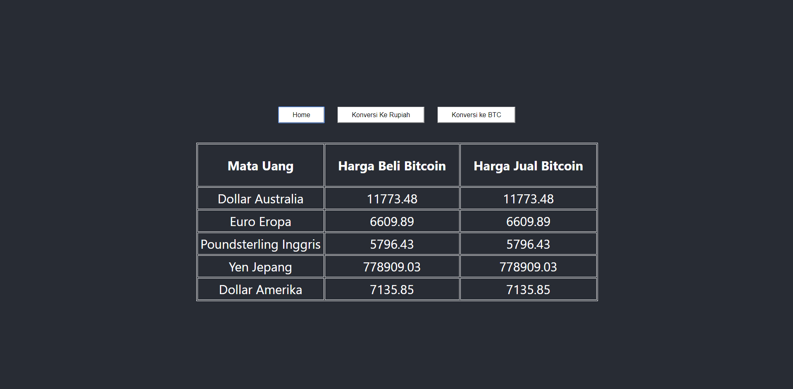

# Bitcoin Currency Tracker and Converter

> A simple Bitcoin currency exchange rate tracker and bidirectional Rupiah (IDR) converter built with React.



---

## 🚀 Features

- **Live Bitcoin Market Rates**: Fetches live buy and sell prices across major global currencies (AUD, EUR, GBP, JPY, USD) via the Blockchain.com Ticker API.
- **BTC to Rupiah (IDR) Conversion**: Calculates Bitcoin value in Indonesian Rupiah based on live USD Bitcoin rates.
- **Rupiah (IDR) to BTC Conversion**: Converts Rupiah amounts to Bitcoin via real-time Blockchain.com conversion API.
- **Multi-Route Navigation**: Seamless tab navigation powered by React Router.

---

## 🛠️ Tech Stack & APIs

- **Frontend**: [React](https://reactjs.org/) (Class Components)
- **Routing**: [React Router v5](https://v5.reactrouter.com/)
- **Build Tool**: Create React App
- **APIs**:
  - `https://blockchain.info/ticker` (Live fiat exchange rates)
  - `https://blockchain.info/tobtc` (Fiat to BTC conversion)

---

## 💻 Local Development

### Prerequisites

- Node.js (v14 - v18 recommended for React 16 / CRA 3)
- npm or yarn

### Installation

1. **Clone the repository:**
   ```bash
   git clone https://github.com/RaihanStark/bitcoin-app.git
   cd bitcoin-app
   ```

2. **Install dependencies:**
   ```bash
   npm install --legacy-peer-deps
   ```

3. **Start the development server:**
   ```bash
   npm start
   ```

4. Open `http://localhost:3000` in your browser.
